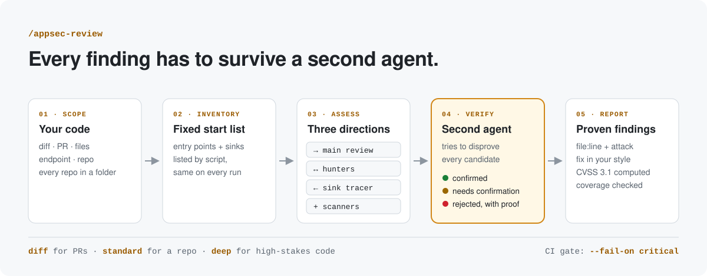

<h1 align="center">appsec-review</h1>

<p align="center">
  <b>Pentest-style security reviews in Claude Code, where every finding has to survive a second agent.</b><br>
  Spring, Node.js, Python, .NET and Go back ends, browser front ends, mobile apps, Supabase and Firebase.
</p>

<p align="center">
  <a href="https://github.com/ibrahimabdallatif/appsec-review/actions/workflows/tests.yml"></a>
  <a href="LICENSE"></a>
  
  
  
</p>

<p align="center">
  <a href="docs/getting-started.md">Getting started</a> ·
  <a href="docs/how-it-works.md">How it works</a> ·
  <a href="docs/ci-pipeline.md">CI pipeline</a> ·
  <a href="CONTRIBUTING.md">Contributing</a>
</p>

<picture>
  <source media="(prefers-color-scheme: dark)" srcset="docs/assets/pipeline-dark.svg">
  
</picture>

## 🧭 Why it's different

<table>
  <tr>
    <td width="50%"><b>Findings are disproved, not just found.</b><br>A fresh verifier agent, which never sees the finder's reasoning, tries to refute each candidate. A rejection must cite the line of code that stops the attack, and rejected candidates are listed so you can overrule them.</td>
    <td width="50%"><b>Coverage is checked by script.</b><br>A scripted inventory lists every entry point and dangerous sink. The ledger validator fails the run if any of them was skipped, so every run covers the same ground.</td>
  </tr>
  <tr>
    <td><b>It knows your framework.</b><br>Rules for Spring, Node, Python, .NET, Go, web front ends, mobile apps and Supabase/Firebase, plus deep playbooks for object-level authorization, payment callbacks, idempotency and race conditions.</td>
    <td><b>Audit-ready output.</b><br>Each finding gives <code>file:line</code>, the attack, the impact and a fix using your own helpers, mapped to OWASP, ASVS, MASVS, CWE and PCI DSS, with CVSS 3.1 computed by script, never estimated.</td>
  </tr>
</table>

## ✨ Features

### 🔍 Code review engine

- **Scripted inventory**: lists every route, handler, consumer, screen, deep link and dangerous sink per stack, so
  each run starts from the same ground (`method/inventory.py`)
- **Forward and backward assessment**: follows each input from entry point to sink, while a sink tracer works back
  from every dangerous call (`deep`)
- **STRIDE and threat model**: trust boundaries, data classes, attacker goals and abuse paths, each worked to its
  goal or to the line that stops it
- **Change-aware diff review**: finds the commit that added a removed control, reads the callers of changed
  helpers, and flags security controls without a negative test
- **Library-aware**: reads the source of the locked dependency version instead of guessing what it does
- **Chain pass**: combines verified findings into worse end-to-end outcomes and verifies each hand-off

### 🧪 Vulnerability coverage

- **Access control**: IDOR/BOLA, function-level authorization, mass assignment, multi-tenancy, SSRF
- **Authentication and sessions**: JWT, OAuth and OIDC, step-up and OTP, passwords, session handling, SAML,
  WebAuthn and passkeys, MFA downgrade, account recovery and linking, API keys, mTLS
- **Injection and input**: SQL and LIKE, command, expression language, CRLF, XXE, deserialization, file handling
- **Business logic**: workflow integrity, money movement, payment callbacks, idempotency, race conditions, replay,
  enumeration, resource limits
- **Web protocol**: request smuggling, cache poisoning and deception, host and forwarded-header trust
- **Client side**: DOM XSS, token storage, CSP, deep links, WebViews, mobile storage and platform APIs
- **Cryptography and data**: secrets, crypto misuse, TLS, card and personal data (PCI DSS)
- **Configuration and supply chain**: exposed tooling, headers and cookies, dependencies, CI, containers, IaC
- **AI and LLM agents**: dangerous capability combinations, tool authorization, MCP identity, RAG and memory tenant
  isolation, model output handling, spend limits
- **Logging and errors**: missing security events, secrets in logs, verbose errors, fail-open handling

### 🤖 Independent verification

- **Hunters**: wildcard, obvious-things and sink-trace subagents look for what the main pass missed
- **Fresh verifiers**: a subagent that never saw the finder's reasoning tries to disprove each candidate
- **Rejection review**: every rejected `critical` or `bug` candidate gets a second, independent look
- **Transparent rejections**: rejected candidates are listed with the line that disproves them, so you can
  overrule them

### 📊 Reporting and CI

- **Audit-ready report**: private HTML report with executive summary, threat model, remediation plan and appendix
- **CVSS 3.1 by script**: every score computed by `report/cvss31.py`, never estimated
- **Coverage ledger**: entry point × category units, validated against the inventory by `method/ledger.py`
- **CI gate and SARIF**: `--fail-on <severity>`, time-limited accepted risks, SARIF export for code scanning
- **Multi-repository reviews**: findings shared across repositories reported once as platform-wide
- **Benchmarks**: `evals/benchmark.py` scores runs against known findings and decoys

## 🧱 Supported stacks

| Stack | Frameworks |
|---|---|
| Java and Kotlin | Spring Boot, MVC, WebFlux, Security, Data |
| Node.js | NestJS, Express, Fastify, Koa, Hapi, Hono, and server code in Next.js and other full-stack frameworks |
| Python | Django, Django REST Framework, FastAPI, Flask, Starlette |
| .NET | ASP.NET Core MVC, Web API, minimal APIs, Blazor |
| Go | net/http, Gin, Echo, Fiber, chi, gRPC |
| Browser front ends | React, Next.js, Angular, Vue, Nuxt, Svelte, Solid, Astro |
| Mobile | React Native, Expo, Flutter, native Android and iOS |
| Backend as a service | Supabase, Firebase |

Each stack has a rule file in `rules/stacks/` and inventory patterns that list its entry points and sinks. Code
in other stacks gets only the general category checks, without a scripted inventory, so coverage is weaker; the
report says when no stack file matched.

## 🛡️ Standards covered

> [!IMPORTANT]
> Every finding is mapped to the standards below, and the report lists the ones each review was based on.

| Standard | Used for |
|---|---|
| **OWASP Top 10:2025** | Web application risk categories |
| **OWASP API Security Top 10:2023** | API risks: BOLA, broken function-level authorization, mass assignment |
| **OWASP ASVS 5.0** (incl. V3 Web Frontend Security) | Verification requirements for back ends and browser front ends |
| **OWASP WSTG-CLNT** | Client-side testing for web front ends |
| **OWASP MASVS, MASTG, MASWE** | Mobile app security requirements and testing |
| **OWASP Mobile Top 10:2024** | Mobile risk categories |
| **CWE Top 25** | Root-cause weakness IDs on every finding |
| **PCI DSS** | Card data handling and payment flows |
| **NIST SP 800-63B-4** | Passwords, authenticators and session rules |
| **RFC 9700** | OAuth 2.0 security best current practice |
| **RFC 8252** | OAuth 2.0 for native apps |
| **RFC 10017** | OAuth 2.0 for browser-based apps |
| **CVSS 3.1** | Severity scoring, computed by script |

## 🚀 Quick start

```sh
git clone https://github.com/ibrahimabdallatif/appsec-review.git ~/.claude/skills/appsec-review
```

Then, in Claude Code, inside the repository to review:

```
/appsec-review                               # current branch vs. its base, plus uncommitted changes
/appsec-review whole repo                    # the whole repository
/appsec-review deep                          # in-depth review for high-stakes code
```

> [!TIP]
> Start with a plain `/appsec-review` on a branch. It is the fastest mode and shows you the output format before
> you spend time on a whole repository. More commands: [Getting started](docs/getting-started.md).

The skill runs only when you invoke it (`disable-model-invocation: true`). Python 3 is needed for its helper
scripts; gitleaks, trivy, semgrep and your ecosystem's audit tool are used when installed.

## 🎚️ Modes

| Mode | Use it for | Subagents | Coverage ledger |
|---|---|---|---|
| `diff` | A branch, PR or files (default) | None, except one verifier for a surviving `critical` | None |
| `standard` | A whole repository, an endpoint, or several repositories | One hunter, one batch verifier, one reviewer for rejected serious candidates | Module × category |
| `deep` | High-stakes code, only when you say "deep" | Two hunters (incl. a backward sink tracer), one verifier per serious candidate | Entry point × category |

Every mode reads all in-scope code and follows each input to its sinks; modes change how many agents run and how
detailed the ledger is. `deep` takes several times longer and uses much more tokens than `standard`.

## 📋 What you get

Findings ordered by severity (`critical`, `bug`, `warning`, `suggestion`), each one like this (illustrative):

```
[Security] Order id not bound to caller (API1, CWE-639)        critical
src/orders/OrderController.java:42

Attack: any signed-in user sends GET /orders/{id} with another customer's order id.
Impact: read access to every customer's orders.
Fix:    load through orderRepository.findByIdAndCustomerId(id, principal.customerId()).
```

Then the "needs confirmation" findings with the exact fact to check, what was checked and found clean, the
coverage summary, the candidates rejected by verification, and a run summary with time and tokens. Every run
also publishes a private HTML report with CVSS 3.1 scores and standards references for each finding.

## 🔁 In CI

The review always runs to completion. A separate gate reads the finished ledger and fails the build on findings at
or above a severity:

```sh
python -I method/ledger.py ~/.appsec-review/<repo>/coverage-ledger.json \
  --inventory ~/.appsec-review/<repo>/inventory.json --fail-on critical
```

Exit codes: `0` pass, `3` blocking findings, `1` incomplete review or invalid ledger, `2` bad arguments. Add
`--accepted <file>` to waive findings the team has accepted, each until an expiry date and up to a severity;
waived findings are still printed. `--sarif <file>` exports the findings for GitHub code scanning or Jenkins.
Agent setup, accepted risks, SARIF, a Jenkins example and scheduling advice:
[docs/ci-pipeline.md](docs/ci-pipeline.md).

> [!WARNING]
> Ledgers, inventories and reports describe how to attack open issues. They are kept in `~/.appsec-review/`,
> outside your repository, and reports are published privately. Check who can see them before sharing.

## 📚 Reference

<details>
<summary><b>🪜 How a review runs, step by step</b></summary>

1. Start a run timer (paused while waiting for the user) and note the token budget.
2. Pick the repositories (single or multi-repository review).
3. Identify the stack from manifests, pick matching stack rules, and build the scripted inventory of entry points
   and sinks (`method/inventory.py`).
4. Set the scope and load the category rules whose `paths` match files in scope.
5. Seed the coverage ledger, and write the threat model and abuse paths: what an attacker wants and how they
   would try to get it (`standard` and `deep`).
6. Assess the code forward from each entry point (trust boundaries, STRIDE, rule checks) while hunters run in
   parallel: wildcard and obvious-things, and in `deep` a sink tracer working backward from every sink. Then
   work each abuse path to its goal, or to the line of code that stops it.
7. Optionally run installed tools: gitleaks, trivy/osv-scanner, ecosystem audits, semgrep.
8. Verify every candidate with a disproof pass and, depending on the mode, independent verifier subagents,
   then look for chains: findings that combine into a worse outcome, verified as a chain.
9. Close the ledger, validate it against the inventory, then report.

The full picture, with a diagram: [docs/how-it-works.md](docs/how-it-works.md).

</details>

<details>
<summary><b>🗂️ Repository layout</b></summary>

| Path | Contents |
|---|---|
| `SKILL.md` | The skill definition: modes, steps, output and report rules |
| `rules/00-overview.md` | Method, STRIDE pass, severity scale and reporting format |
| `rules/*.md` | Framework-neutral category checklists: access control, authentication and sessions, injection, cryptography and data protection, business logic, configuration and supply chain, logging, client side, AI/LLM agents, web protocol and identity |
| `rules/stacks/*.md` | Framework add-ons: Java/Spring, Node, web front end, mobile, Python, .NET, Go, Supabase and Firebase |
| `rules/deep/*.md` | `deep`-mode playbooks: object-level authorization, payment callbacks, payment state and idempotency, race conditions, business-logic flaws |
| `method/` | Coverage ledger, hunter and verifier prompts, `inventory.py`, `ledger.py` validator and CI gate, `accepted_risks.py`, `sarif.py`, `run_stats.py` |
| `report/` | Report structure (`REPORT.md`), CVSS 3.1 calculator (`cvss31.py`) and HTML template |
| `docs/` | Getting started, how it works, CI pipeline guide, and the README images |
| `evals/` | `benchmark.py`, which scores one run, or several runs for stability, against known findings |
| `.github/workflows/tests.yml` | Runs every test suite on Linux and Windows on each push and pull request |

</details>

<details>
<summary><b>🛠️ Development</b></summary>

Run the tests after changing the helper scripts (GitHub Actions runs the same commands on every push):

```sh
python -I method/test_inventory.py
python -I method/test_ledger.py
python -I method/test_accepted_risks.py
python -I method/test_sarif.py
python -I method/test_threat_model.py
python -I method/test_run_stats.py
python -I evals/test_benchmark.py
python -I report/cvss31.py --selftest
```

After changing `rules/`, `method/` or the steps, score the skill against a benchmark repository with
`evals/benchmark.py`, over several fresh runs, to make sure no known finding is lost or only found sometimes. See
[CONTRIBUTING.md](CONTRIBUTING.md).

</details>

## 📄 Credits and license

MIT, see [LICENSE](LICENSE). Parts of this skill are adapted from MIT-licensed projects by Cloudflare, Vasiliy
Uvarov, Riyan Dhiman and Mohamed AboElKheir, with ideas from Trail of Bits and autoresearch; see
[NOTICE.md](NOTICE.md).
