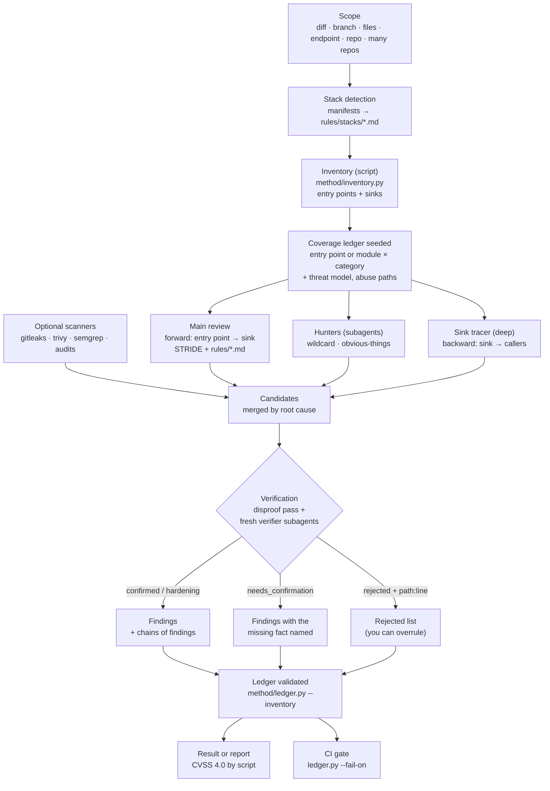

# How it works

A review turns code into verified findings in five stages. Each stage has one job, and the files that define it
are listed below so you can read or change the exact behaviour.

### Terms used on this page

| Term | Plain meaning |
|---|---|
| **Inventory** | A scripted map of the doors into the application and the sensitive actions inside it. Every whole-repository review starts from the same map. |
| **Sink** | A sensitive action that untrusted input might reach, such as a database query, shell command, file write or request to another service. |
| **Trust boundary** | A point where data moves from a less-trusted user or system into a more-sensitive part of the application. |
| **Coverage ledger** | The review's checklist of record: what was examined, which files were read, what happened, and which findings resulted. A validator compares it with the inventory so skipped areas remain visible. |
| **Ledger unit** | One item in that checklist: a code surface, such as an entry point or module, crossed with one security category. |
| **Threat model** | The short picture of what is worth attacking, who might attack it, and where trust changes. |
| **STRIDE** | Six questions for finding threats: spoofing identity, tampering with data, repudiation, information disclosure, denial of service and elevation of privilege. |
| **Abuse path** | A concrete attacker goal traced until it succeeds or a specific control stops it. |
| **Hunter** | An extra pass that looks for weaknesses outside the category checklist, including odd features and mistakes that look obvious. |
| **Sink trace** | The deep-mode pass that starts at a sensitive action and walks backward through its callers to see who can reach it. |
| **Candidate** | A possible weakness that has not been verified yet. |
| **Finding** | A candidate that survived verification and is included in the result. |
| **Verifier** | A fresh pass whose job is to try to show that a candidate is not real. |
| **Disproof** | The exact `path:line` of the control that stops an attack. A rejection has to cite one. |
| **Chain** | Multiple verified findings that combine into a more serious end-to-end attack. |

## 1. Scope and stack

The skill works out what to review (`SKILL.md` steps 1 and 3) and which stacks the code uses, from its manifests
(`pom.xml`, `package.json`, `composer.json`, `go.mod`, `*.csproj`, workflow files, `Dockerfile`, `*.tf`, …).
Each detected stack adds a framework file from `rules/stacks/` naming that framework's entry points and unsafe
APIs. Category files in `rules/` load when their `paths` front matter matches files in scope.

## 2. Inventory and ledger (`standard` and `deep`)

`method/inventory.py` lists every entry point (routes, consumers, jobs, deep links, screens) and every dangerous
sink (SQL, commands, deserialization, file access, outbound HTTP, redirects, crypto, tokens, DOM and WebView
APIs) with regex patterns from `method/inventory_patterns.py`. It is a script, so the same commit always gives the
same list.

The coverage ledger (`method/coverage-ledger.md`) turns that list into units:

- `standard`: one unit per module (file) × category.
- `deep`: one unit per entry point × category.
- In both, a threat model (assets, actors, trust boundaries) and **abuse paths**: concrete goals such as "a
  customer reads another customer's card number", at least one per asset (`method/threat-model.md`). They
  give the review a top-down view: what an attacker wants, not only what each entry point allows.

Each unit ends with the paths read and one line per check. The ledger lives in `~/.appsec-review/<repo>/`,
outside the reviewed repository.

## 3. Assessment from three directions

- **Main review, forward.** Starting at each entry point, the main session follows input to where it lands,
  runs a STRIDE pass, and checks every matching rule. It reads the middleware, guards, filters and config the code
  relies on before deciding.
- **Hunters, sideways** (`method/hunters.md`). The wildcard hunter looks outside the checklist: odd code,
  half-finished features, what the API allows that the UI never asks for. The obvious-things hunter checks the
  basics everyone assumes someone else checked: hardcoded secrets, debug routes, permissive CORS, open redirects.
- **Sink tracer, backward** (`deep` only). Starting at each inventory sink, it traces the dangerous argument back
  through its callers to an entry point, and answers every sink as candidate, safe, unreachable or blocked.

- **Abuse paths, top-down** (`standard` and `deep`). After the forward pass, each abuse path is worked as an
  attacker would: the cheapest route to the goal, step by step. It closes as realised (linked to findings) or
  blocked, citing the `path:line` of the control that stops it.

Installed scanners add their hits too. Everything found at this stage is a **candidate**, not a finding.

| Mode | Hunters | Verifiers |
|---|---|---|
| `diff` | Both hunter lists run inline | Disproof pass; one verifier subagent only if a `critical` survives it |
| `standard` | One subagent with both hunter lists | One verifier subagent for all candidates |
| `deep` | Two subagents: wildcard + obvious-things, and the sink tracer | One verifier per `critical`/`bug` candidate, plus one per category for the rest |

That table is the parallel path. A sequential run, or a host that cannot spawn an agent, does the same prompts
inline and labels the result self-verified. A serious rejection is upheld only by a second agent; otherwise it
stays "needs confirmation" (`method/orchestration.md`).

## 4. Verification

The agent that found a candidate never decides whether it is real (`method/verifier.md`).

1. **Disproof pass.** After the assessment, every candidate is re-read as if someone else wrote it: re-open each
   cited line and look for the control that stops the attack.
2. **Fresh verifier subagents.** A new agent gets the candidate and the file paths, not the finder's reasoning,
   and tries to refute it. It must restate the attack precisely, rebuild the strongest control on the path, and
   check the severity against the evidence. It may reject a candidate only by citing the `path:line` of the code
   that disproves it; "not sure" is never a rejection. A rejected `critical` or `bug` candidate goes to a second
   fresh verifier, which checks whether the cited line really stops the attack on every path; the ledger
   validator fails a rejected serious candidate without that review.

Decisions are `confirmed`, `hardening`, `needs_confirmation` (with the one external fact that decides it) or
`rejected`. Rejected candidates are listed at the end of the result so you can overrule them.

3. **Chain pass.** Verification judges each weakness alone, so two warnings that together take over an
   account would stay two warnings. After it, the findings are checked for chains: one gives the next what it
   needs (a leaked id, a redirect that carries a token, a race past a limit). A chain is reported as its own
   finding at the end-to-end severity, after a verifier checks each hand-off between the links. The validator
   rejects a chain that is no worse than its worst link, or confirmed while a link is not.

## 5. Ledger validation, result and gate

`method/ledger.py` validates the ledger before any result is written: every unit closed with evidence, every
finding linked, every rejection proven. With `--inventory` it also fails when an inventory entry point has no unit
or a sink file was never read under its category, so a run cannot quietly skip part of its scope.

The result orders findings by severity with `file:line`, the attack, the impact and a fix that uses the codebase's
own helpers, and ends with a run summary (`method/run_stats.py`: time and tokens). The report
(`report/REPORT.md`), built by every `standard` and `deep` run and by a `diff` run when asked, adds CVSS 4.0 vectors computed by `report/cvss40.py` and standards references per finding.

In CI, `ledger.py --fail-on <severity>` reads the finished ledger and exits non-zero on findings at or above the
threshold ([ci-pipeline.md](ci-pipeline.md)), except findings waived by an accepted-risk file until its expiry
date. It never stops a review early. `ledger.py --sarif` exports the same findings as SARIF for GitHub code
scanning or Jenkins.

## 6. Where the skill runs

Claude Code, Cursor and Codex load the same `skills/appsec-review/` instructions. Hunters and verifiers are
subagents when `method/parallel_mode.py` prints `parallel` and the host can spawn one. Otherwise the
coordinator runs those prompts itself and says so. The coverage check stays a pass over the ledger, not a
fourth agent. Install paths and the limits of what was executed on each host are in
[platforms.md](platforms.md).

## Repeatability

A review uses a language model, so two runs can differ. Three things keep results consistent:

- the inventory gives every run the same entry points and sinks to cover, and the validator enforces it;
- later runs build on the ledger: unchanged units keep their status and earlier findings are re-verified, so
  results accumulate instead of varying;
- `evals/benchmark.py` scores several fresh runs against known findings and flags any that are only found
  sometimes, so the rule or pattern behind them can be fixed ([CONTRIBUTING.md](../CONTRIBUTING.md)).
