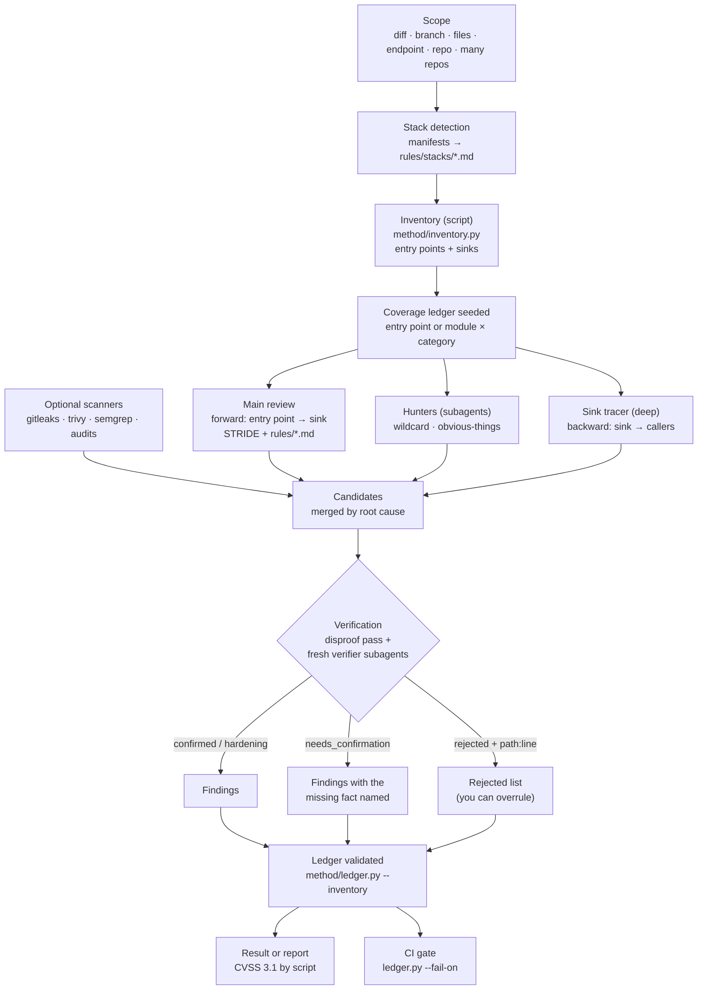

# How it works

A review turns code into verified findings in five stages. Each stage has one job, and the files that define it
are listed below so you can read or change the exact behaviour.

## 1. Scope and stack

The skill works out what to review (`SKILL.md` steps 1 and 3) and which stacks the code uses, from its manifests
(`pom.xml`, `package.json`, `go.mod`, `*.csproj`, …). Each detected stack adds a framework file from
`rules/stacks/` naming that framework's entry points and unsafe APIs. Category files in `rules/` load when their
`paths` front matter matches files in scope.

## 2. Inventory and ledger (`standard` and `deep`)

`method/inventory.py` lists every entry point (routes, consumers, jobs, deep links, screens) and every dangerous
sink (SQL, commands, deserialization, file access, outbound HTTP, redirects, crypto, tokens, DOM and WebView
APIs) with regex patterns from `method/inventory_patterns.py`. It is a script, so the same commit always gives the
same list.

The coverage ledger (`method/coverage-ledger.md`) turns that list into units:

- `standard`: one unit per module (file) × category.
- `deep`: one unit per entry point × category.

Each unit ends with the paths read and one line per check. The ledger lives in `~/.appsec-review/<repo>/`,
outside the reviewed repository.

## 3. Assessment from three directions

- **Main review, forward.** Starting at each entry point, the main session follows input to where it lands,
  runs a STRIDE pass, and checks every matching rule. It reads the middleware, guards, filters and config the code
  relies on before deciding.
- **Hunters, sideways** (`method/hunters.md`). The wildcard hunter looks outside the checklist: odd code,
  half-finished features, what the API allows that the UI never asks for. The obvious-things hunter checks the
  basics everyone assumes someone else checked: hardcoded secrets, debug routes, permissive CORS, open redirects.
- **Sink tracer, backward** (`deep` only). Starting at each inventory sink, it traces the dangerous argument back
  through its callers to an entry point, and answers every sink as candidate, safe, unreachable or blocked.

Installed scanners add their hits too. Everything found at this stage is a **candidate**, not a finding.

| Mode | Hunters | Verifiers |
|---|---|---|
| `diff` | Both hunter lists run inline | Disproof pass; one verifier subagent only if a `critical` survives it |
| `standard` | One subagent with both hunter lists | One verifier subagent for all `critical`, `bug` and `warning` candidates |
| `deep` | Two subagents: wildcard + obvious-things, and the sink tracer | One verifier per `critical`/`bug` candidate, plus one per category for the rest |

## 4. Verification

The agent that found a candidate never decides whether it is real (`method/verifier.md`).

1. **Disproof pass.** After the assessment, every candidate is re-read as if someone else wrote it: re-open each
   cited line and look for the control that stops the attack.
2. **Fresh verifier subagents.** A new agent gets the candidate and the file paths, not the finder's reasoning,
   and tries to refute it. It must restate the attack precisely, rebuild the strongest control on the path, and
   check the severity against the evidence. It may reject a candidate only by citing the `path:line` of the code
   that disproves it; "not sure" is never a rejection.

Decisions are `confirmed`, `hardening`, `needs_confirmation` (with the one external fact that decides it) or
`rejected`. Rejected candidates are listed at the end of the result so you can overrule them.

## 5. Ledger validation, result and gate

`method/ledger.py` validates the ledger before any result is written: every unit closed with evidence, every
finding linked, every rejection proven. With `--inventory` it also fails when an inventory entry point has no unit
or a sink file was never read under its category, so a run cannot quietly skip part of its scope.

The result orders findings by severity with `file:line`, the attack, the impact and a fix that uses the codebase's
own helpers, and ends with a run summary (`method/run_stats.py`: time and tokens). A report
(`report/REPORT.md`) adds CVSS 3.1 vectors computed by `report/cvss31.py` and standards references per finding.

In CI, `ledger.py --fail-on <severity>` reads the finished ledger and exits non-zero on findings at or above the
threshold ([ci-pipeline.md](ci-pipeline.md)). It never stops a review early.

## Repeatability

A review uses a language model, so two runs can differ. Three things keep results consistent:

- the inventory gives every run the same entry points and sinks to cover, and the validator enforces it;
- later runs build on the ledger: unchanged units keep their status and earlier findings are re-verified, so
  results accumulate instead of varying;
- `evals/benchmark.py` scores several fresh runs against known findings and flags any that are only found
  sometimes, so the rule or pattern behind them can be fixed ([CONTRIBUTING.md](../CONTRIBUTING.md)).
